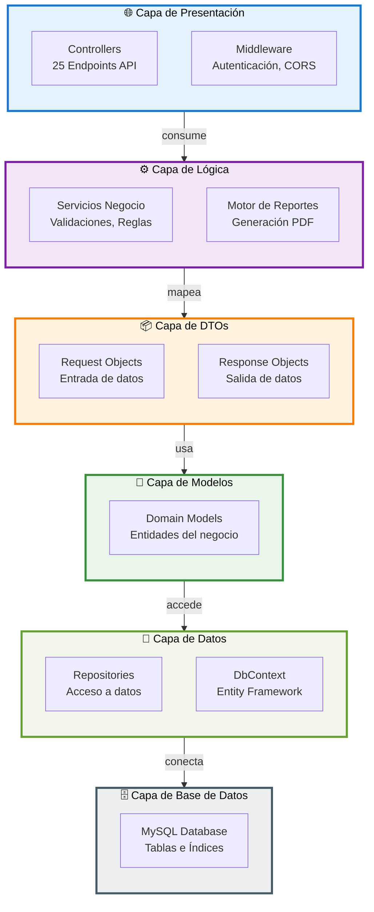
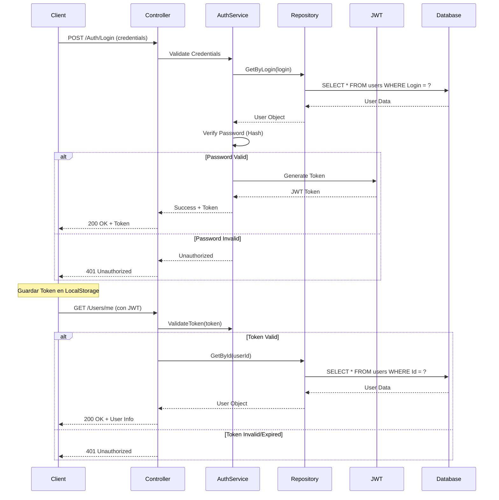
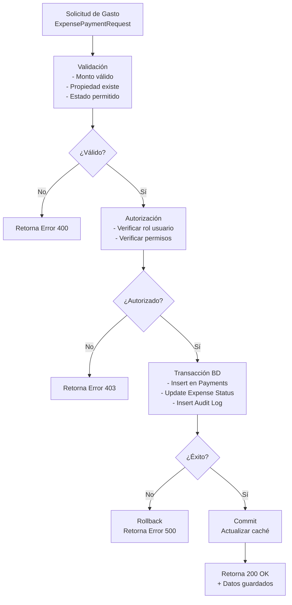

# Arquitectura Backend - CondoAdmin

## Descripción General

CondoAdmin Backend es una API REST desarrollada con **.NET 8.0** y **ASP.NET Core**, siguiendo patrones de arquitectura en capas (Layered Architecture). La aplicación utiliza **MySQL** como base de datos, **Entity Framework Core** para el acceso a datos, y **JWT Bearer** para autenticación y seguridad. Implementa RBAC (Role-Based Access Control) y maneja múltiples entidades complejas relacionadas con la gestión de condominios.

## Stack Tecnológico

- **Framework**: ASP.NET Core (.NET 8.0)
- **Base de Datos**: MySQL 8.0+
- **ORM**: Entity Framework Core
- **Autenticación**: JWT Bearer (Microsoft.AspNetCore.Authentication.JwtBearer)
- **Logging**: Serilog (con salida a archivo)
- **Validación**: Data Annotations
- **Documentación API**: Swagger (Swashbuckle.AspNetCore)
- **Configuración**: DotNetEnv (variables de entorno)

---

## Diagrama Simplificado de Capas



---

## Diagramas por Capa

### Capa de Presentación - Controllers

```mermaid
graph TB
    subgraph CoreControllers["🔐 Controladores Core"]
        Auth["AuthController<br/>POST /Auth/Login<br/>POST /Auth/logout"]
        Health["HealthController<br/>GET /Health"]
        AuthHealth["AuthHealthCheckController<br/>GET /AuthHealthCheck"]
    end
    
    subgraph UserManagementControllers["👥 Controladores de Usuarios"]
        Users["UsersController<br/>GET/POST/PUT/DELETE /Users<br/>GET /Users/me"]
        Role["RoleController<br/>GET/POST /Role"]
        PasswordValidation["PasswordValidationDemoController<br/>Password validation endpoints"]
    end
    
    subgraph PropertyControllers["🏠 Controladores de Propiedades"]
        Property["PropertyController<br/>GET/POST/PUT /Property<br/>GET /PropertyType"]
        PropertyType["PropertyTypeController<br/>GET/POST /PropertyType"]
        PropertyOwners["PropertyOwnersController<br/>GET/POST /PropertyOwners"]
    end
    
    subgraph ExpenseControllers["💰 Controladores de Expensas"]
        Expenses["ExpensesController<br/>GET/POST /Expenses"]
        ExpenseCategories["ExpenseCategoriesController<br/>GET/POST /ExpenseCategories"]
        ExpensePayments["ExpensePaymentsController<br/>GET/POST /ExpensePayments"]
    end
    
    subgraph PaymentControllers["💳 Controladores de Pagos"]
        Payments["PaymentsController<br/>GET/POST /Payments"]
        PaymentStatus["PaymentStatusController<br/>GET/POST /PaymentStatus"]
    end
    
    subgraph ServiceControllers["🔧 Controladores de Servicios"]
        ServiceTypes["ServiceTypesController<br/>GET/POST /ServiceTypes"]
        ServiceExpenses["ServiceExpensesController<br/>GET/POST /ServiceExpenses"]
        ServicePayments["ServicePaymentsController<br/>GET/POST /ServicePayments"]
        ServiceExpensePayments["ServiceExpensePaymentsController<br/>Complex payment processing"]
    end
    
    subgraph ResourceControllers["📦 Controladores de Recursos"]
        Resources["ResourcesController<br/>GET/POST /Resources"]
        ResourceCosts["ResourceCostsController<br/>GET/POST /ResourceCosts"]
        ResourceBookings["ResourceBookingsController<br/>GET/POST /ResourceBookings"]
    end
    
    subgraph IncidentControllers["⚠️ Controladores de Incidentes"]
        Incidents["IncidentsController<br/>GET/POST /Incidents"]
        IncidentTypes["IncidentTypesController<br/>GET/POST /IncidentTypes"]
        IncidentCosts["IncidentCostsController<br/>GET/POST /IncidentCosts"]
    end
    
    subgraph ReportControllers["📊 Controladores de Reportes"]
        Reports["ReportsController<br/>GET/POST /Reports<br/>Generación de PDF"]
    end
    
    classDef coreStyle fill:#0277bd,stroke:#01579b,stroke-width:2px,color:#fff
    classDef userStyle fill:#0288d1,stroke:#0277bd,stroke-width:2px,color:#fff
    classDef propStyle fill:#0291d2,stroke:#0277bd,stroke-width:2px,color:#fff
    classDef expStyle fill:#0299d2,stroke:#0277bd,stroke-width:2px,color:#fff
    classDef payStyle fill:#02a8d2,stroke:#0277bd,stroke-width:2px,color:#fff
    classDef servStyle fill:#03b8d2,stroke:#0277bd,stroke-width:2px,color:#fff
    classDef resStyle fill:#04b9d2,stroke:#0277bd,stroke-width:2px,color:#fff
    classDef incStyle fill:#05badd,stroke:#0277bd,stroke-width:2px,color:#fff
    classDef repStyle fill:#06c7dd,stroke:#0277bd,stroke-width:2px,color:#fff
    
    class Auth,Health,AuthHealth coreStyle
    class Users,Role,PasswordValidation userStyle
    class Property,PropertyType,PropertyOwners propStyle
    class Expenses,ExpenseCategories,ExpensePayments expStyle
    class Payments,PaymentStatus payStyle
    class ServiceTypes,ServiceExpenses,ServicePayments,ServiceExpensePayments servStyle
    class Resources,ResourceCosts,ResourceBookings resStyle
    class Incidents,IncidentTypes,IncidentCosts incStyle
    class Reports repStyle
```



### Capa de DTOs - Data Transfer Objects

```mermaid
graph TB
    subgraph AuthDTOs["🔐 DTOs de Autenticación"]
        LoginReq["LoginRequest<br/>- Login: string<br/>- Password: string"]
        UpdatePasswordReq["UpdatePasswordRequest<br/>- OldPassword: string<br/>- NewPassword: string"]
    end
    
    subgraph UserDTOs["👤 DTOs de Usuarios"]
        UserReq["UserRequest<br/>- User_Name: string<br/>- Last_Name: string<br/>- Legal_Id: string<br/>- Password: string"]
        UserRoleReq["UserRoleRequest<br/>- User_Id: int<br/>- Role_Id: int"]
    end
    
    subgraph PropertyDTOs["🏠 DTOs de Propiedades"]
        PropertyReq["PropertyRequest<br/>- Legal_Id: string<br/>- Tower: string<br/>- Floor: int<br/>- Code: string"]
        PropertyTypeReq["PropertyTypeRequest<br/>- Type: string<br/>- Rooms: int<br/>- Bathrooms: int"]
        PropertyOwnerReq["PropertyOwnerRequest<br/>- Property_Id: int<br/>- User_Id: int"]
    end
    
    subgraph ExpenseDTOs["💰 DTOs de Expensas"]
        ExpenseReq["ExpenseRequest<br/>- Category_Id: int<br/>- Property_Id: int<br/>- Amount: decimal<br/>- Start_Date: DateTime"]
        ExpenseCatReq["ExpenseCategoryRequest<br/>- Category: string<br/>- Description: string"]
        ExpensePayReq["ExpensePaymentRequest<br/>- Expense_Id: int<br/>- Amount: decimal<br/>- Payment_Date: DateTime"]
    end
    
    subgraph ServiceDTOs["🔧 DTOs de Servicios"]
        ServiceTypeReq["ServiceTypeRequest<br/>- Service_Name: string<br/>- Description: string"]
        ServiceExpReq["ServiceExpenseRequest<br/>- Service_Type_Id: int<br/>- Description: string<br/>- Amount: decimal"]
        ServicePayReq["ServicePaymentRequest<br/>- Service_Expense_Id: int<br/>- Amount: decimal<br/>- Payment_Date: DateTime"]
    end
    
    subgraph ResourceDTOs["📦 DTOs de Recursos"]
        ResourceReq["ResourceRequest<br/>- Resource_Name: string<br/>- Description: string<br/>- Status: string"]
        ResourceCostReq["ResourceCostRequest<br/>- Resource_Id: int<br/>- Amount: decimal"]
        ResourceBookReq["ResourceBookingRequest<br/>- Resource_Id: int<br/>- Property_Id: int<br/>- Start_Date: DateTime"]
    end
    
    subgraph IncidentDTOs["⚠️ DTOs de Incidentes"]
        IncidentReq["IncidentRequest<br/>- Incident_Type_Id: int<br/>- Property_Id: int<br/>- Description: string"]
        IncidentTypeReq["IncidentTypeRequest<br/>- Type_Name: string<br/>- Description: string"]
        IncidentCostReq["IncidentCostRequest<br/>- Incident_Id: int<br/>- Amount: decimal"]
    end
    
    subgraph ReportDTOs["📊 DTOs de Reportes"]
        ReportReq["ReportRequest<br/>- Report_Name: string<br/>- Description: string"]
        ReportExecReq["ReportExecutionRequest<br/>- Report_Id: int<br/>- Parameters: ReportParam[]"]
        ReportPdfResp["ReportPdfResponse<br/>- PdfContent: byte[]<br/>- FileName: string"]
    end
    
    classDef dtoAuthStyle fill:#ffb74d,stroke:#f57c00,stroke-width:2px,color:#000
    classDef dtoUserStyle fill:#ffc668,stroke:#f57c00,stroke-width:2px,color:#000
    classDef dtoPropStyle fill:#ffd700,stroke:#f57c00,stroke-width:2px,color:#000
    classDef dtoExpStyle fill:#ffda70,stroke:#f57c00,stroke-width:2px,color:#000
    classDef dtoServStyle fill:#ffe082,stroke:#f57c00,stroke-width:2px,color:#000
    classDef dtoResStyle fill:#ffeb99,stroke:#f57c00,stroke-width:2px,color:#000
    classDef dtoIncStyle fill:#fff176,stroke:#f57c00,stroke-width:2px,color:#000
    classDef dtoRepStyle fill:#ffb74d,stroke:#f57c00,stroke-width:2px,color:#000
    
    class LoginReq,UpdatePasswordReq dtoAuthStyle
    class UserReq,UserRoleReq dtoUserStyle
    class PropertyReq,PropertyTypeReq,PropertyOwnerReq dtoPropStyle
    class ExpenseReq,ExpenseCatReq,ExpensePayReq dtoExpStyle
    class ServiceTypeReq,ServiceExpReq,ServicePayReq dtoServStyle
    class ResourceReq,ResourceCostReq,ResourceBookReq dtoResStyle
    class IncidentReq,IncidentTypeReq,IncidentCostReq dtoIncStyle
    class ReportReq,ReportExecReq,ReportPdfResp dtoRepStyle
```



### Capa de Modelos - Domain Models

```mermaid
graph TB
    subgraph CoreModels["🎯 Modelos Core"]
        User["User<br/>- Id: int (PK)<br/>- Login: string<br/>- User_Name: string<br/>- Password: string<br/>- Legal_Id: string"]
        Role["Role<br/>- Id: int (PK)<br/>- Rol_Name: string<br/>- Description: string"]
        UserRole["UserRole<br/>- Role_Id: int (FK)<br/>- User_Id: int (FK)"]
    end
    
    subgraph PropertyModels["🏠 Modelos de Propiedades"]
        Property["Property<br/>- Id: int (PK)<br/>- Legal_Id: string<br/>- Tower: string<br/>- Floor: int<br/>- Code: string"]
        PropertyType["PropertyType<br/>- Id: int (PK)<br/>- Type: string<br/>- Rooms: int<br/>- Bathrooms: int"]
        PropertyOwner["PropertyOwner<br/>- Property_Id: int (FK)<br/>- User_Id: int (FK)"]
    end
    
    subgraph ExpenseModels["💰 Modelos de Expensas"]
        Expense["Expense<br/>- Id: int (PK)<br/>- Category_Id: int (FK)<br/>- Property_Id: int (FK)<br/>- Amount: decimal<br/>- Status_Id: int (FK)"]
        ExpenseCategory["ExpenseCategory<br/>- Id: int (PK)<br/>- Category: string<br/>- Description: string"]
        ExpensePayment["ExpensePayment<br/>- Id: int (PK)<br/>- Expense_Id: int (FK)<br/>- Amount: decimal<br/>- Payment_Date: DateTime"]
        PaymentStatus["PaymentStatus<br/>- Id: int (PK)<br/>- Status_Description: string"]
    end
    
    subgraph ServiceModels["🔧 Modelos de Servicios"]
        ServiceType["ServiceType<br/>- Id: int (PK)<br/>- Service_Name: string<br/>- Description: string"]
        ServiceExpense["ServiceExpense<br/>- Id: int (PK)<br/>- Service_Type_Id: int (FK)<br/>- Amount: decimal"]
        ServicePayment["ServicePayment<br/>- Id: int (PK)<br/>- Service_Expense_Id: int (FK)<br/>- Amount: decimal"]
    end
    
    subgraph ResourceModels["📦 Modelos de Recursos"]
        Resource["Resource<br/>- Id: int (PK)<br/>- Resource_Name: string<br/>- Description: string<br/>- Status: string"]
        ResourceCost["ResourceCost<br/>- Id: int (PK)<br/>- Resource_Id: int (FK)<br/>- Amount: decimal"]
        ResourceBooking["ResourceBooking<br/>- Id: int (PK)<br/>- Resource_Id: int (FK)<br/>- Property_Id: int (FK)"]
    end
    
    subgraph IncidentModels["⚠️ Modelos de Incidentes"]
        Incident["Incident<br/>- Id: int (PK)<br/>- Incident_Type_Id: int (FK)<br/>- Property_Id: int (FK)"]
        IncidentType["IncidentType<br/>- Id: int (PK)<br/>- Type_Name: string"]
        IncidentCost["IncidentCost<br/>- Id: int (PK)<br/>- Incident_Id: int (FK)<br/>- Amount: decimal"]
    end
    
    subgraph ReportModels["📊 Modelos de Reportes"]
        Report["Report<br/>- Id: int (PK)<br/>- Report_Name: string<br/>- Description: string"]
        ReportSection["ReportSection<br/>- Id: int (PK)<br/>- Report_Id: int (FK)"]
        ReportHeader["ReportHeader<br/>- Id: int (PK)<br/>- Report_Id: int (FK)"]
        ReportFooter["ReportFooter<br/>- Id: int (PK)<br/>- Report_Id: int (FK)"]
    end
    
    %% Relationships
    User --> UserRole
    Role --> UserRole
    Property --> PropertyOwner
    User --> PropertyOwner
    PropertyType --> Property
    
    ExpenseCategory --> Expense
    Property --> Expense
    PaymentStatus --> Expense
    Expense --> ExpensePayment
    
    ServiceType --> ServiceExpense
    ServiceExpense --> ServicePayment
    
    Resource --> ResourceCost
    Resource --> ResourceBooking
    Property --> ResourceBooking
    
    IncidentType --> Incident
    Property --> Incident
    Incident --> IncidentCost
    
    Report --> ReportSection
    Report --> ReportHeader
    Report --> ReportFooter
    
    classDef coreModelStyle fill:#a5d6a7,stroke:#388e3c,stroke-width:2px,color:#000
    classDef propModelStyle fill:#c8e6c9,stroke:#43a047,stroke-width:2px,color:#000
    classDef expModelStyle fill:#81c784,stroke:#2e7d32,stroke-width:2px,color:#000
    classDef servModelStyle fill:#66bb6a,stroke:#1b5e20,stroke-width:2px,color:#000
    classDef resModelStyle fill:#4caf50,stroke:#1b5e20,stroke-width:2px,color:#000
    classDef incModelStyle fill:#7cb342,stroke:#558b2f,stroke-width:2px,color:#fff
    classDef repModelStyle fill:#9ccc65,stroke:#689f38,stroke-width:2px,color:#000
    
    class User,Role,UserRole coreModelStyle
    class Property,PropertyType,PropertyOwner propModelStyle
    class Expense,ExpenseCategory,ExpensePayment,PaymentStatus expModelStyle
    class ServiceType,ServiceExpense,ServicePayment servModelStyle
    class Resource,ResourceCost,ResourceBooking resModelStyle
    class Incident,IncidentType,IncidentCost incModelStyle
    class Report,ReportSection,ReportHeader,ReportFooter repModelStyle
```



### Capa de Datos - Repository Pattern

```mermaid
graph TB
    subgraph RepositoryPattern["💾 Patrón Repository"]
        IRepository["IRepository<T><br/>- GetAll()<br/>- GetById(id)<br/>- Add(entity)<br/>- Update(entity)<br/>- Delete(id)<br/>- SaveChanges()"]
    end
    
    subgraph UserRepositories["👤 User Repositories"]
        UserRepo["IUserRepository<br/>- GetByLogin(login)<br/>- ChangePassword(id, pass)<br/>- GetUserRoles(id)"]
        RoleRepo["IRoleRepository<br/>- GetByName(name)"]
        UserRoleRepo["IUserRoleRepository<br/>- GetUserRoles(userId)<br/>- AddUserRole(userId, roleId)"]
    end
    
    subgraph PropertyRepositories["🏠 Property Repositories"]
        PropRepo["IPropertyRepository<br/>- GetByTower(tower)<br/>- GetByUser(userId)"]
        PropTypeRepo["IPropertyTypeRepository<br/>- GetByType(type)"]
        PropOwnerRepo["IPropertyOwnerRepository<br/>- GetByProperty(propId)"]
    end
    
    subgraph ExpenseRepositories["💰 Expense Repositories"]
        ExpRepo["IExpenseRepository<br/>- GetByCategory(catId)<br/>- GetByProperty(propId)<br/>- GetByStatus(statusId)"]
        ExpCatRepo["IExpenseCategoryRepository<br/>- GetByName(name)"]
        ExpPayRepo["IPaymentRepository<br/>- GetByExpense(expId)<br/>- GetByDate(startDate)"]
    end
    
    subgraph ServiceRepositories["🔧 Service Repositories"]
        ServTypeRepo["IServiceTypeRepository<br/>- GetByName(name)"]
        ServExpRepo["IServiceExpenseRepository<br/>- GetByType(typeId)"]
        ServPayRepo["IServicePaymentRepository<br/>- GetByExpense(expId)"]
    end
    
    subgraph ResourceRepositories["📦 Resource Repositories"]
        ResRepo["IResourceRepository<br/>- GetByName(name)<br/>- GetAvailable()"]
        ResCostRepo["IResourceCostRepository<br/>- GetCurrent(resId)"]
        ResBookRepo["IResourceBookingRepository<br/>- GetByProperty(propId)<br/>- CheckAvailability(resId, dates)"]
    end
    
    subgraph IncidentRepositories["⚠️ Incident Repositories"]
        IncRepo["IIncidentRepository<br/>- GetByType(typeId)<br/>- GetByProperty(propId)"]
        IncTypeRepo["IIncidentTypeRepository"]
        IncCostRepo["IIncidentCostRepository"]
    end
    
    subgraph DataContext["🔗 Entity Framework Context"]
        DBContext["CondominioContext<br/>- DbSet<User><br/>- DbSet<Role><br/>- DbSet<Property><br/>- DbSet<Expense><br/>- ... (todas las entidades)<br/>- OnModelCreating()"]
    end
    
    IRepository -.inherited by.-> UserRepo
    IRepository -.inherited by.-> PropRepo
    IRepository -.inherited by.-> ExpRepo
    IRepository -.inherited by.-> ServTypeRepo
    IRepository -.inherited by.-> ResRepo
    IRepository -.inherited by.-> IncRepo
    
    UserRepo --> DBContext
    RoleRepo --> DBContext
    PropRepo --> DBContext
    ExpRepo --> DBContext
    ServTypeRepo --> DBContext
    ResRepo --> DBContext
    IncRepo --> DBContext
    
    classDef interfaceStyle fill:#e1bee7,stroke:#7b1fa2,stroke-width:2px,color:#000
    classDef userRepoStyle fill:#f3e5f5,stroke:#6a1b9a,stroke-width:2px,color:#000
    classDef propRepoStyle fill:#ede7f6,stroke:#512da8,stroke-width:2px,color:#000
    classDef expRepoStyle fill:#e8eaf6,stroke:#3f51b5,stroke-width:2px,color:#000
    classDef servRepoStyle fill:#e3f2fd,stroke:#1976d2,stroke-width:2px,color:#000
    classDef resRepoStyle fill:#e0f2f1,stroke:#00897b,stroke-width:2px,color:#000
    classDef incRepoStyle fill:#f1f8e9,stroke:#558b2f,stroke-width:2px,color:#000
    classDef dbStyle fill:#eceff1,stroke:#455a64,stroke-width:2px,color:#000
    
    class IRepository interfaceStyle
    class UserRepo,RoleRepo,UserRoleRepo userRepoStyle
    class PropRepo,PropTypeRepo,PropOwnerRepo propRepoStyle
    class ExpRepo,ExpCatRepo,ExpPayRepo expRepoStyle
    class ServTypeRepo,ServExpRepo,ServPayRepo servRepoStyle
    class ResRepo,ResCostRepo,ResBookRepo resRepoStyle
    class IncRepo,IncTypeRepo,IncCostRepo incRepoStyle
    class DBContext dbStyle
```



---

## Descripción por Capas

### 1. Capa de Presentación (Controllers)

**Responsabilidades**:
- Recibir solicitudes HTTP
- Validar entrada de datos
- Invocar lógica de negocio
- Retornar respuestas formateadas
- Gestionar autenticación y autorización

**Controllers Principales** (25 total):

| Categoría | Controllers | Endpoints |
|-----------|-----------|-----------|
| **Core** | AuthController, HealthController, AuthHealthCheckController | Login, Logout, Health checks |
| **Usuarios** | UsersController, RoleController | CRUD Users, Roles, Permissions |
| **Propiedades** | PropertyController, PropertyTypeController, PropertyOwnersController | CRUD Properties |
| **Expensas** | ExpensesController, ExpenseCategoriesController, ExpensePaymentsController | Expense management |
| **Pagos** | PaymentsController, PaymentStatusController | Payment processing |
| **Servicios** | ServiceTypesController, ServiceExpensesController, ServicePaymentsController, ServiceExpensePaymentsController | Service management |
| **Recursos** | ResourcesController, ResourceCostsController, ResourceBookingsController | Resource management |
| **Incidentes** | IncidentsController, IncidentTypesController, IncidentCostsController | Incident tracking |
| **Reportes** | ReportsController | Report generation & PDF export |

### 2. Capa de Lógica de Negocio

**Componentes**:

- **Servicios de Negocio**: Validaciones complejas, reglas de negocio
- **Motor de Reportes** (`Condominio.Reports`): 
  - Generación de reportes PDF
  - Manejo de templates
  - Parámetros dinámicos
  - Headers y footers personalizados

- **Validaciones** (`Condominio.DTOs/Validation`):
  - Validación de contraseñas
  - Validación de datos de entrada
  - Reglas de negocio específicas

- **Utilidades** (`Condominio.Utils`):
  - Funciones auxiliares
  - Extensiones de tipos
  - Helpers para conversiones

### 3. Capa de DTOs (Data Transfer Objects)

**Responsabilidades**:
- Transferencia de datos entre capas
- Validación de entrada (Data Annotations)
- Serialización/Desserialización JSON
- Separación de modelos internos

**DTOs Principales** (~40 clases):
- Request objects para cada entidad (UserRequest, PropertyRequest, ExpenseRequest, etc.)
- Response objects para consultas complejas (ReportPdfResponse, ResourceAvailabilityResponse, etc.)
- Objects de validación específica (PasswordValidationRequest, LoginRequest, etc.)

### 4. Capa de Modelos de Dominio

**Entidades Principales** (35+ modelos):

| Entidad | Propiedades Clave | Relaciones |
|---------|------------------|-----------|
| **User** | Id, Login, User_Name, Last_Name, Legal_Id, Password | UserRole (1:N) |
| **Role** | Id, Rol_Name, Description | UserRole (1:N) |
| **Property** | Id, Legal_Id, Tower, Floor, Code, Property_Type_Id | PropertyOwner, Expense, Incident |
| **Expense** | Id, Category_Id, Property_Id, Amount, Status_Id | ExpenseCategory, Property, ExpensePayment |
| **ServiceExpense** | Id, Service_Type_Id, Amount, Description | ServiceType, ServicePayment |
| **Resource** | Id, Resource_Name, Status | ResourceCost, ResourceBooking |
| **Report** | Id, Report_Name, ReportSections, ReportHeader, ReportFooter | Generación PDF |
| **Incident** | Id, Incident_Type_Id, Property_Id, Description | IncidentType, IncidentCost |

**Características**:
- Validación mediante Data Annotations
- Propiedades calculadas
- Métodos de negocio embebidos
- Timestamps de auditoría (Start_Date, End_Date)

### 5. Capa de Datos (Repository Pattern)

**Patrón Repository**:
- Interfaz genérica `IRepository<T>`
- Interfaces específicas para queries complejas
- Implementaciones concretas para cada entidad
- DbContext de Entity Framework Core

**Características**:
- Abstracción de acceso a datos
- Query LINQ
- Lazy loading y eager loading
- Transacciones

**Principales Interfaces**:
- `IUserRepository`, `IRoleRepository`, `IUserRoleRepository`
- `IPropertyRepository`, `IPropertyTypeRepository`, `IPropertyOwnerRepository`
- `IExpenseRepository`, `IExpenseCategoryRepository`, `IPaymentRepository`
- `IServiceTypeRepository`, `IServiceExpenseRepository`
- `IResourceRepository`, `IResourceBookingRepository`
- `IIncidentRepository`

### 6. Capa de Base de Datos

**Motor**: MySQL 8.0+

**Características**:
- Tablas normalizadas
- Índices de rendimiento
- Relaciones foreign key
- Constraints de integridad
- Versionado de esquema (DatabaseVersion)

**Tablas Principales** (~20 tablas):
- Usuarios, Roles, Permisos
- Propiedades, Tipos de Propiedad, Propietarios
- Expensas, Categorías, Pagos
- Servicios, Pagos de Servicios
- Recursos, Costos de Recursos, Reservas
- Incidentes, Costos de Incidentes
- Reportes, Auditoría

---

## Flujo de Autenticación y Autorización



---

## Flujo de Procesamiento de Transacciones



---

## Seguridad Implementada

### 1. Autenticación
- **JWT Bearer Token**: Tokens con expiración configurable
- **Password Hashing**: Algoritmos seguros (PBKDF2)
- **Token Blacklist**: Logout efectivo en tiempo real

### 2. Autorización
- **RBAC (Role-Based Access Control)**: 6 roles definidos
  - `admin`: Acceso total al sistema
  - `super`: Super usuario
  - `director`: Director de condominio
  - `habitante`: Residente
  - `auxiliar`: Personal auxiliar
  - `seguridad`: Personal de seguridad
  
- **Atributos `[Authorize]`**: Protección por rol en controllers

### 3. Validación de Datos
- **Data Annotations**: Validación declarativa
- **Fluent Validation**: Reglas complejas
- **Sanitización**: Prevención de inyección

### 4. Logging y Auditoría
- **Serilog**: Logging a archivo con rotación diaria
- **Audit Logs**: Registro de cambios importantes
- **Request/Response Logging**: Trazabilidad

### 5. CORS y Seguridad HTTP
- **CORS Configurado**: Origen permitido desde variable de entorno
- **HTTPS**: Recomendado en producción
- **Headers de Seguridad**: Protección contra ataques comunes

---

## Stack de Proyectos .NET

```
CondominioAPI.sln
├── CondominioAPI (ASP.NET Core)
│   ├── Controllers (25)
│   ├── Middleware
│   ├── Security
│   └── Program.cs
├── Condominio.DTOs
│   ├── Request Objects (~20)
│   ├── Response Objects (~10)
│   └── Validation
├── Condominio.Models
│   ├── Domain Models (35+)
│   ├── Enumerations
│   └── Interfaces
├── Condominio.Repository
│   ├── Repositories (~20)
│   ├── DbContext
│   └── Migrations
├── Condominio.Data.Mysql
│   └── Database Context & Configuration
├── Condominio.Reports
│   ├── Report Engine
│   ├── PDF Generation
│   └── Templates
├── Condominio.Utils
│   ├── Extensiones
│   ├── Helpers
│   └── Constantes
├── Condominio.Tests
│   ├── Unit Tests
│   ├── Integration Tests
│   └── Fixtures
└── Condominio.Benchmarks
    └── Performance Testing
```

---

## Configuración y Entorno

### Variables de Entorno Requeridas
```env
DB_SERVER=localhost
DB_NAME=condominio_db
DB_USER=root
DB_PASSWORD=password
JWT_SECRET_KEY=your-secret-key-here
CORS_ALLOWED_ORIGIN=http://localhost:5173
LOG_PATH=Logs/log-.txt
```

### Logging Configuration (Serilog)
- **Output**: Archivos diarios en carpeta `Logs/`
- **Tamaño máximo**: 10 MB por archivo
- **Rotación**: Diaria con sufijo fecha
- **Nivel**: Debug en desarrollo, Information en producción

---

## Patrones de Diseño Utilizados

### 1. **Repository Pattern**
- Abstracción de acceso a datos
- Facilita testing
- Independencia del ORM

### 2. **Dependency Injection**
- Contenedor built-in de ASP.NET Core
- Ciclo de vida: Transient, Scoped, Singleton
- Inyección en constructores

### 3. **SOLID Principles**
- **Single Responsibility**: Cada clase tiene una responsabilidad
- **Open/Closed**: Extensible sin modificar código existente
- **Liskov Substitution**: Interfaces genéricas intercambiables
- **Interface Segregation**: Interfaces específicas
- **Dependency Inversion**: Depender de abstracciones

### 4. **Factory Pattern**
- Creación de objetos DTOs
- Mapeo de modelos

### 5. **Unit of Work Pattern**
- DbContext actúa como UoW
- Múltiples repositories con misma transacción
- SaveChanges() centralizado

---

## Mejoras Futuras Recomendadas

1. **Caché Distribuido**: Redis para caché de sesiones
2. **Message Queue**: RabbitMQ para procesamiento async
3. **CQRS**: Separación de lecturas y escrituras
4. **Event Sourcing**: Auditoría completa de cambios
5. **GraphQL**: API alternativa más eficiente
6. **gRPC**: Comunicación interna de microservicios
7. **Unit Testing**: Mayor cobertura con xUnit
8. **API Versioning**: Manejo de múltiples versiones
9. **Rate Limiting**: Control de tasa de solicitudes
10. **Search Engine**: Elasticsearch para búsquedas complejas

---

## Conclusión

La arquitectura del backend de CondoAdmin sigue principios empresariales sólidos:

- **Arquitectura en Capas**: Separación clara de responsabilidades
- **SOLID Principles**: Código mantenible y testeable
- **Security-First**: Autenticación, autorización y auditoría integradas
- **Scalability**: Preparada para crecimiento
- **Maintainability**: Fácil de entender, actualizar y extender

Esta estructura permite el desarrollo colaborativo, testing efectivo y despliegue seguro en múltiples entornos.
